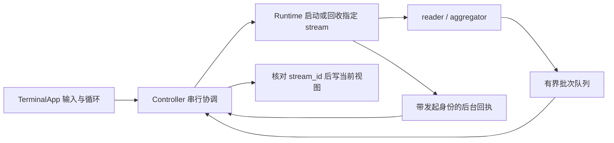

# ArkLog M1：真实代码设计实验与上下文缺口

本轮完成当前代码映射、真实 Rust 契约实验、故意错误对照、一次测试反馈修正和完整原生门禁。
决定保留现有 Controller 设计，没有修改 ArkLog 工作区或强行引入第二种架构。
结果是 `completed_with_context_gap`：原生实验链路成立，但 Memory 尚不能为这个 Rust 范围提供
自动源码上下文。当前不进入 M2，也不把本轮解释为 Agent 设计能力、长期效能或真实设备验收。

## 1. 输入、版本与授权范围

- 用户提供的 `SUMMARY.md` 是 M0 有限模型的运行摘要，明确声明不是 ArkLog 实测。本轮没有
  原 M0 执行器，未重放其 136 种顺序，也未把其中两个 `PASS_MODEL_ONLY` 方案当成设计胜出证据。
- `CODEX_NEXT_TASK.md` 指定真实试点为 ArkLog 的设备切换和旧事件隔离，允许只读检查和隔离实验，
  禁止推送、部署、操作生产设备或删除已有工作。本轮按该任务执行，没有安装额外工作流。
- ArkLog 工作区：`/Users/liuhui/Documents/code/ArkLog`，分支 `main`，提交
  `9aa4c503c271ab22375ec5e40e645f536b441c11`，tree
  `1b0a369cf3da1e350b930fa45bf85d0459502ef8`，开始时无未提交修改。
- 202 个原始跟踪文件的清单摘要为
  `d93bc2ed3320ef9eedaf481252699648891bbde10ffdb52697543d6e7b706c5e`。
  输入文件 SHA-256、源码清单、检查定义和工具版本见[最终输入](evidence/arklog-m1-20261116-delivery/input.json)。
- Agent Memory 基线为 `320e95137a890403cbd6496858a8a1c7de79c6ec`。只调用原有
  `tools/agent_memory.py`，为本次试验显式指定临时 Memory Home，没有修改其生产实现或业务归档。

ArkLog 的 `AGENTS.md` 要求 TDD，生产 UI 为 Rust + Ratatui。当前
`docs/specs/stream-intent-control.md` 是相关 Accepted 合同。旧
`smooth-lossless-streaming.md` 还包含 React 对象描述，不能据此把 React/Tauri 当成本轮生产入口；
只将其中正常 Stop 的尾批次和无损背压要求与当前合同、代码、测试核对。

## 2. 当前真实代码映射

以下位置均绑定上述 ArkLog 提交，行号不是对任意未来版本的承诺。

| 责任 | 实际位置 | 当前行为 |
| --- | --- | --- |
| 生产调用者 / 唯一协调者 | `crates/arklog-tui/src/main.rs:177,246,602` | `TerminalApp` 持有 Controller，循环串行泵批次与后台回执，快捷键调用 `toggle_stream` |
| 运行意图与替换入口 | `crates/arklog-tui/src/controller.rs:161,178,190` | `DesiredStream` 表达用户最终意图；`reconcile_stream` 等待 discovery、Stop、reap 和重试边界 |
| 有效批次校验与应用 | `controller.rs:365` | 在同一个 `&mut self` 调用内比较完整 `stream_id` 并立即 `append_lines` |
| 设备选择 | `controller.rs:432` | 当前目标仍 online 时保留；目标不可用且仅一个 online 候选时选中；多候选等待用户 |
| 异步 Stop | `controller.rs:339`、`controller/background.rs:10` | 捕获发起时的流 ID；所有者以 `stopping_stream` 关联回执，再协调后续动作 |
| 异步 reap | `controller/stream_health.rs:7,44` | worker 捕获 `reaping_id`，不会在后台读取新的 Controller 绑定 |
| 流身份生成 / 进程所有权 | `crates/arklog-core/src/runtime.rs:55,100,134` | 同一 Runtime 内递增 `stream-N`；每条流拥有 child 与聚合 worker |
| 完成身份 | `runtime.rs:184` | `DeviceLogStreamExit` 携带被检查流的 ID，另一条流启用不改变该 ID |
| 读取与聚合 | `crates/arklog-core/src/stream.rs:24,80` | reader / aggregator 捕获固定流 ID，经有界队列发送带身份的批次 |
| 原有日志查询通道 | `crates/arklog-tui/src/mcp_runtime.rs:103` | 查询快照在 UI 循环中取得 `&mut Controller`；后台连接不直接修改 Controller |



四个核心问题的答案：

1. **有效身份在哪里判断？** `pump_log_batches_limited` 在同一所有者方法中完成检查与写入。
   普通安全 Rust 调用路径没有在二者之间 `await`、回调到另一所有者或重新读取外部绑定。
   这是所有者的逻辑串行边界，不是声称一个 CPU 原子指令完成整次 I/O。
2. **完成事件是否保留发起身份？** Stop closure 捕获原 ID，Controller 保存对应 ID；reap closure
   捕获原 ID，Runtime 的完成结构也保留该 ID。新增真实 Runtime 测试同时保持另一条流活跃后核对它。
3. **同设备重连是否新身份？** 同一 Runtime 的 `AtomicU64::fetch_add` 为两次实际启动产生不同
   `stream_id`，即使 `device_id` 相同。这个保证的范围是 Runtime 与其队列生命周期，不是全局唯一 ID。
4. **谁负责停止、清理、提交启动？** Controller 负责意图和时序，Runtime 终止并等待 child、join
   worker，Controller 消费回执后才提交替换流。Runtime 先从表中移除流，再等待清理，故
   `has_stream=false` 本身不能代替“清理回执已消费”。

手动 Stop 保留原流身份，边排空队列边等待尾批次；目标替换则先撤销旧身份。两种情况都继续
排空有界队列，避免丢弃旧数据的策略变成 worker 无法结束。原有正常 Stop 尾批次测试继续执行。

## 3. 设计候选与取舍

本轮只有一个正向候选：**保留当前串行 Controller + Runtime + stream_id**。
代表性实现就是上述实际代码，原生验证直接编译这份代码，不把 M0 Python 模型改名当成实现。

- 核心状态：Controller 的 `desired_stream`、`active_stream`、Stop/reap 回执槽和现有设备选择。
- 调用路径：`TerminalApp → toggle_stream / pump_background_tasks → reconcile_stream → Runtime`；
  数据返回为 `Runtime → bounded queue → Controller 身份比较 → ArkLogState`。
- 成立条件：遵守当前安全 Rust 所有权边界；生产启动通过协调入口；流清理完成回执先于替换提交；
  有效身份按完整 stream ID 判断。
- 迁移与替代：业务迁移代价为零，不替代现有生产逻辑。新增内容是隔离的测试适配与实验记录。
- 可证伪性：当前有效批次丢失、同设备旧代次写入、完成身份被当前绑定替换，或新流先于旧回执提交，
  任意一项都会让对应原生检查失败。
- 结构代价：所有者必须持续排空队列并消费后台回执；部分完成处理依靠前置时序保证，不能随意删除
  Stop/reap 门控后还假定其安全。当前没有足够依据增加 DeviceWatcher、SessionManager 或通用 actor。

`poll_stream_health` 的完成分支并非逐项比较“当前 ID == 完成 ID”后再更新全部状态。
当前生产路径通过启动门控确保处理旧回执时尚未提交替换流。故意移除门控的实验确实出现
“替换流已绑定，旧回执将状态改成 Stopped”的反例，验证了这个时序条件的必要性。

另有公开便捷入口 `start_stream → start_stream_now`，不能把它推断成所有情况下都执行了
`reconcile_stream` 的等待条件。当前生产 TUI 启动调用者使用 `toggle_stream`；该便捷入口的
任意外部调用组合不在本次生产路径结论中。未来若增加调用者，应先对其清理期间调用补回归，
不以本次 TUI 结果为任意调用顺序背书。

## 4. 最小执行器与验证器自检

[执行器](../tests/run_arklog_m1.py) 只编排本次实验的 Cargo/libtest 和既有 Memory 上下文命令，
不成为生产 Runtime、MCP 服务、Agent wrapper 或候选生成服务。

它以 `git archive` 复制干净基线到临时目录，独立设置 Cargo 输出、临时文件和 Memory Home，
离线复用本机已有 crate 缓存；HDC 只使用已有假程序，PATH 中的防护程序阻止意外查找真实 `hdc`。
命令有超时，前后保存被测内容摘要，记录发现数、实际退出码、失败 ID、输出哈希及工具版本。

四项新检查按行为逐步接入。测试定义与故意错误的代码改动分开保存：

- [检查定义](evidence/arklog-m1-20261116-delivery/checks.json)
- [仅测试适配补丁](evidence/arklog-m1-20261116-delivery/test-adapter.patch)
- [全部丢弃对照](evidence/arklog-m1-20261116-delivery/variants/drop_all.patch)
- [只比较设备对照](evidence/arklog-m1-20261116-delivery/variants/device_only.patch)
- [完成身份重绑对照](evidence/arklog-m1-20261116-delivery/variants/completion_rebound.patch)
- [破坏回收顺序对照](evidence/arklog-m1-20261116-delivery/variants/unsafe_completion_order.patch)

测试适配只在临时副本增加一个 `cfg(test)` 模块。两个批次检查从测试适配器向实际有界队列放入
带实际 Runtime 流 ID 的消息，再调用真实公共 pump 观察视图；并未复制或模拟业务判断函数。
其中同设备旧消息是故意注入的失效传输输入，不是声称已 join 的生产 worker 还能自然发送数据。
另外两项使用真实 Runtime 完成结构及 Controller 的真实发现 / Stop 回执路径。

| 对照 | 最终检查观察 | 结论 |
| --- | --- | --- |
| 当前有效实现 | 四项新契约检查均通过 | 在本轮受控条件下保留现有设计 |
| 全部丢弃 | `M1_CURRENT` 未保留，当前有效批次断言失败 | 不能用全丢弃假装隔离成功 |
| 只比较设备 ID | 同设备 `stream-1 → stream-2` 后旧消息进入视图 | 新检查拒绝该实现 |
| 完成身份重绑 | 请求 `stream-1`，另一条 `stream-2` 活跃，完成却报告 `stream-2` | 原生身份断言失败 |
| 破坏回收顺序 | 回执未消费时绑定 `stream-2`，随后状态成为 `Stopped` | 原生顺序 / 状态断言失败 |

另用实际执行验证了[零测试、退出码 7 和超时](evidence/arklog-m1-20261116-validator-checks/result.json)
都被执行器拒绝。构建 / 上下文命令的“零测试”仅表示它们不是测试命令；平台限定二进制在当前
平台发现零项也不代表对应平台已验收。执行器没有通用依赖图或模型预算调度器。

## 5. 一条完整的反馈修正记录

1. 现有 `device_switch_discards_the_old_streams_late_partial_batch` 在当前实现中通过。
2. 在临时副本把围栏故意改为只比较 `device_id`，这个 A→B 用例仍通过：它不能区分这类错误。
3. 修正实验，增加同设备两次真实启动、不同流 ID 的队列边界检查。
4. 同一个错误对照实际失败，输出包含
   `old=stream-1 current=stream-2 device=USB-01 rows=["M1_STALE", "M1_CURRENT"]`。
5. 恢复现有完整流 ID 围栏后检查通过，随后全量原生门禁执行。

这里修正的是验证缺口，未把“错误对照存在缺陷”偷换成“当前 ArkLog 存在这个缺陷”。
四项新探针不穷举所有线程顺序，不等价于 M0 的 136 种有限模型排列。

## 6. 实际命令与结果

最终一次完整复跑的[18 条命令记录](evidence/arklog-m1-20261116-delivery/commands.json)
逐条绑定源清单和原始输出；完整结果见[result.json](evidence/arklog-m1-20261116-delivery/result.json)。

| 检查 | 实际结果 | 本次命令耗时 |
| --- | --- | --- |
| 原始聚焦基线 | 32 项通过 | 编译及初始运行记录独立保留 |
| 新增四项契约探针 | 4 项通过 | 2.912 s |
| 四种故意错误 | 各由指定检查拒绝，均为断言失败而非编译失败 | 逐项见命令记录 |
| `pnpm test` | 193 项通过，0 失败 / 忽略 | 76.291 s |
| `pnpm build` | release 构建通过 | 9.407 s |
| `cargo test --workspace --locked --offline` | 193 项通过，0 失败 / 忽略 | 31.917 s |
| `cargo check -p arklog --locked --offline` | 通过 | 1.376 s |
| `cargo test -p arklog-core --test live_start` | 1 项通过，确认显式 UnsupportedLiveStart | 2.075 s |

193 项已包含四项新探针；pnpm 与直接 Cargo 入口重复执行同一测试集合，不是 386 个独立案例。
环境为 macOS、Rust/Cargo 1.95.0、Node 21.6.2、pnpm 8.3.1。项目声明 pnpm 10.12.1，
本轮没有安装或升级工具；当前 `pnpm test/build` 实际运行的是 package.json 中的原生 Cargo 脚本。

历史结果保留：

- [首次尝试](evidence/arklog-m1-20261115-attempt-1/result.json)：现有 MCP 的两项本机端口测试被
  沙箱阻止，pnpm 门禁实际失败；没有跳过后称为通过。
- [授权后尝试](evidence/arklog-m1-20261115-final/result.json)：设备发现的超量输出回收用例触发
  `< 1s` 时延断言失败，176 项通过、1 项失败。
- [固定一次诊断及剩余检查](evidence/arklog-m1-20261115-followup/commands.json)：同一时延用例单独
  复测通过，构建 / workspace / check 通过。不能据此抹去前一次失败或断言根因。
- 调整执行器为“某个独立门禁失败后仍继续其他门禁”，随后对当前版本做上述最终完整复跑。
  此后未调整时延阈值、生产代码或失败定义，没有继续复跑以选择更好的结果。

复跑方式（从本仓库根目录、以本次干净 ArkLog 基线为输入）：

```bash
python3 -m tests.run_arklog_m1 \
  --source /path/to/ArkLog \
  --evidence /tmp/new-arklog-m1-evidence
```

证据目录必须不存在。临时快照默认保留供审阅；原始业务工作区保持只读。主机必须允许本机
端口测试，并已有离线 crate 缓存；缺少依赖、端口权限或超时会记录未完成，不自动改环境使其通过。
Cargo 参数和输出目录机制参考官方 [cargo test](https://doc.rust-lang.org/cargo/commands/cargo-test.html)
与[环境变量文档](https://doc.rust-lang.org/cargo/reference/environment-variables.html)。

## 7. Memory 集成的实际缺口

本轮确实用原有 Runtime 在独立 Memory Home 执行了：

1. 对 `crates/arklog-tui/src` 执行 `learn-path`，实际 `files_indexed=0`。
2. 普通 `design-context` 返回 0 个仓库源码锚点。
3. 根据反馈显式传入 Controller / Runtime 路径及已确认约束，再次执行 `design-context`，仍为
   0 个源码锚点，`sufficiency=needs_anchor_confirmation`。

[实际上下文结果](evidence/arklog-m1-20261116-delivery/memory-context.json)保留了该缺口。
当前 `source_adapters.py` / `models.CODE_EXTENSIONS` 未注册 `.rs`，而显式锚点查询仍需已索引的
`code_files`；换查询措辞不能补出实际 Rust 文件。返回的一般设计知识不是这个项目的源码证据。

因此，这次实际代码理解来自 Agent 直接读取源码，实验执行由 Cargo/libtest 完成。Memory
没有选择方案、生成候选、解释根因或接管测试执行。没有为了得到漂亮结果而伪造 Rust 索引、
转用已退出生产路径的 TypeScript 前端，或增加一个通用 MCP 服务。

下一步如扩展 Memory，应先以独立开发夹具定义最小 Rust 文件 / 符号上下文合同及可核验锚点，
再决定实现范围；本次只读 M1 任务没有修改该生产能力。

## 8. 未验证项与 M2 决策

- **LiveOnly 真机验收：未验证 / BLOCKED。** 本轮只证明已有明确拒绝语义，未证明真机 cursor / attach
  边界。没有使用真机、清理设备日志、编造设备参数或将 ExistingBuffer 改称 LiveOnly。
- **跨平台与所有并发顺序：未证明。** 仅本机原生测试、指定队列注入及假 HDC 场景；Windows
  专属检查在本机不构成运行证据。
- **时延断言稳定性：仍需解释。** 保留一次完整门禁中的现有时延失败，不能把后续通过当成根因已定位。
- **Memory 自动 Rust 源码供给与收益：未证明。** 当前返回为空，M1 只能证明直接源码检查和原生
  实验工具的路径，不能称完整的 Memory 辅助 Rust 设计集成已通过。
- **M2：本轮不启动。** 先关闭或明确冻结上述上下文能力边界，再选择未泄露解法的新任务，按相同
  基线、模型、预算和共同验收比较默认 Agent / 仅 Skill / Skill+工具，并记录失败、返工与额外成本。
  已公开的错误对照及本轮已接触任务不作为新的隐藏任务；历史 sealed holdout 保持原样。

当前有价值的交付是：一份真实代码映射、保留既有设计的取舍、可重放的原生实验、已证明的测试
盲区修正，以及一个明确的 Memory Rust 能力缺口。没有生产发布或模型能力提升结论。
