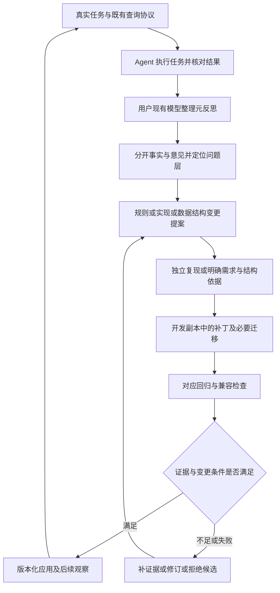

# 系统元反思与演进：研究依据及完整改进方案

状态：声明范围内的前台生命周期、隔离安装与真实 Codex 示例触发已有验收结果；不是已批准 ADR 或效能结论
日期：2026-10-30
静态核对基线：`2ade686f12373c214d7b9c3809f0e8821d770944`

用户希望在真实使用中，借助当前 Agent 的大模型检查并改进整个 Agent Memory：
系统规则、查询、学习、反思、数据结构及配套交付都属于目标，记忆和经验维护
只是其中一条路径。对外继续保持原有查询协议的正常运作。

本次修订将目标扩展为完整的系统演进流程：从真实观察定位机制问题，形成规则、
实现或数据模型变更提案，在开发副本中准备补丁及必要迁移，再用对应检查决定
是否应用、发布和回退。元反思报告是入口；最终交付应是带证据和版本的实际
系统变更。本次已将触发、预算、报告/提案和状态规则收敛到
[v1 设计规格](system-meta-reflection-design.zh-CN.md)，并编写 Reflect/Maintain
的可移植客户端协议，以及[独立治理记录初版](system-meta-reflection-runtime.zh-CN.md)。
Runtime 显式保存、读取、有限状态审计、[显式检查记录](system-meta-reflection-checks.zh-CN.md)
和[声明驱动的触发判断和显式名额](system-meta-reflection-triggers.zh-CN.md)已有合成隔离回归通过结果。
另有[独立候选准备和 v2 主体绑定](system-meta-reflection-candidates.zh-CN.md)，同样经过合成回归；
首次执行记录保留在[设计第 9 节](system-meta-reflection-design.zh-CN.md#9-隔离验证记录)，
当前完整范围与未覆盖项见[完成证据矩阵](system-meta-reflection-completion.zh-CN.md)。
专用[生命周期入口](system-meta-reflection-lifecycle.zh-CN.md)已补齐晋级、文件应用、
迁移/回退与实际目录检查，并验证安装副本及一个真实 Codex 示例触发。
当前开发版本的监测采集器也已依据受控失败修复；额外业务项目部署需具体目标，
不把这些结果当成所有宿主、任意数据模型或生产效能的结论。

本文查阅论文原文页面、作者项目与官方产品文档，区分来源结论和本项目设计推断。
Context7 的 LangSmith、Langfuse 文档解析请求因连接错误失败，改读其官方网页。
最初调研未安装相关框架、调用模型或运行验证；后续按用户隔离验证授权实施，
已实际执行本地回归、临时安装副本及现有 Codex 宿主示例。未创建评测包或采集生产任务。
本文保留完整目标与未来范围；已有接口以生命周期规格和源码为准，当前验收的
安装副本不是未指定的业务项目，宿主示例不是长期真实使用效果。

## 1. 相关理论与实践

以下是与当前问题直接相关的代表性工作，并非完整行业清单。论文中的实验设置、
模型、任务和指标不能直接迁移成本项目收益，也不能替代本仓库的变更证据要求。

| 工作与来源 | 来源能够支持的机制 | 对本项目的采用方式与边界 |
|---|---|---|
| [Reflexion](https://arxiv.org/abs/2303.11366)（2023） | 将任务反馈转成语言反思，并在后续尝试中通过经验记忆使用；不依赖更新模型权重 | 借鉴任务后复盘和可追溯经验；反馈可来自内部模拟，因此一条反思本身不能证明正确性 |
| [Self-Refine](https://arxiv.org/abs/2303.17651)（2023） | 同一个模型生成输出、提出反馈并迭代改写，在论文所测任务中报告改善 | 用户现有模型可以承担评审与修订建议，无需另建模型服务；自评仍须标记为模型意见 |
| [ACE](https://arxiv.org/abs/2510.04618)（2025；2026 修订） | 将上下文作为可演化经验手册，通过生成、反思、整理和结构化增量更新积累知识 | 将观察、评价、变更整理分成步骤，保留条目身份与修订；不据此全面重写记忆或放宽当前上下文预算 |
| [GEPA](https://arxiv.org/abs/2507.19457)（2025；2026 修订） | 根据执行轨迹反思、提出并测试提示更新，维护互补候选；论文提供开源实现 | 改进提案绑定具体基线和评测结果；借鉴小步候选比较，不直接接入自动提示搜索或采集私有推理轨迹 |
| [MemRL](https://arxiv.org/abs/2601.03192)（2026） | 固定模型，通过环境反馈更新经验效用，并在两阶段检索中结合相关性与效用 | 区分内容是否相似、是否被使用、使用结果如何；其 Q 值机制改变检索行为，本轮不引入，不把模型信心当环境奖励 |
| [LLM-as-a-Judge / MT-Bench](https://arxiv.org/abs/2306.05685)（2023） | 研究模型评审与人类偏好的对应，也报告位置、冗长、自我偏好等偏差 | 使用细分准则、证据引用及未知项；对比较任务隐藏候选身份并交换顺序检查，校准分歧后再使用评审信号 |
| [Intrinsic Self-Correction](https://arxiv.org/abs/2310.01798)（2023；ICLR 2024）与 [SCoRe](https://arxiv.org/abs/2409.12917)（2024） | 前者在所测推理设置中发现无外部反馈的自纠正可能无效或退化；后者通过专门多轮强化学习训练改善自纠正 | 避免从早期结果推断所有模型都不能自纠正，也避免把一次自评当保证；本项目采用外部可核验信号，不进行权重训练 |
| [Darwin Gödel Machine](https://arxiv.org/abs/2505.22954)（2025） | 生成修改自身代码的 Agent 变体，并通过编码基准进行经验验证和候选积累 | 代码改进保留基线、补丁与独立验证；该研究不是用户运行环境中直接热更新 Runtime 的依据 |
| [LangSmith Evaluation Types](https://docs.langchain.com/langsmith/evaluation-types)（官方文档，访问于本日） | 区分线上观察与离线基准、回归；生产问题可以成为离线数据集候选 | 线上评审负责发现问题，受控回归负责验证改动；不复制原始生产日志上传的工作方式 |
| [Langfuse Production Evaluation](https://langfuse.com/docs/evaluation/get-started/online)（官方文档，访问于本日） | 将评测器、采样规则、生产观测及用户/人工评分连接起来，并考虑评测成本 | 固定触发与采样规则，区分评分来源并单列额外成本；只借鉴设计，不增加服务依赖或模型连接 |

据此作出的本项目判断是：元反思可以成为改进线索的入口；线上模型评审、
可核验检查和发布判定应分别承担责任。这是设计判断；当前机制验收不构成这些
研究结果在本项目中的效能复现。

## 2. 现有底座与需要补齐的契约

| 现有能力 | 静态源码依据 | 接入元反思时的约束 |
|---|---|---|
| 结构化反思、经验复用与验证方法字段 | [Reflect Skill](../skills/agent-memory-reflect/SKILL.md)、[反思实现](../tools/agent_memory_runtime/reflection_commands.py) | 当前 `task_type` 仅接受 diagnosis/design/execution/workflow；没有独立系统评审类型，不能把新字段示例直接传入现有命令 |
| 经验使用与检索反馈参与后续排序 | [经验使用](../tools/agent_memory_runtime/experience_usage.py)、[检索反馈](../tools/agent_memory_runtime/retrieval_feedback.py) | 元反思初始意见不直接写入这些排序信号，也不自动标记 `verified`、`verified_useful` 或 `confirmed` |
| 反馈稳定性与任务去重辅助 | [反馈政策](../tools/agent_memory_runtime/feedback_policy.py) | 稳定性按验证标记或任务身份等规则判断，不核验引用材料的真实性；重复自评、不同事件 ID 和模型投票不能充当独立证据 |
| 有界任务轨迹、反思质量提示、维护队列 | [轨迹治理](../tools/agent_memory_runtime/task_trace_governance.py)、[维护队列](../tools/agent_memory_runtime/active_learning_queue.py) | 可复用已有可用信息；轨迹中的字段齐全分数不代表任务正确或功能通过，缺失信息仍须明确报告 |
| 确定性 Context 门禁、Agent 对照与真实活动治理 | [能力评测](system-capability-evaluation.md)、[真实任务指南](prospective-cohort-guide.zh-CN.md) | 元反思不替代现有门禁，不补造 Oracle，不将普通使用回顾事后登记成前瞻性活动 |
| 查询分层及版本化 handoff | [Query Skill](../skills/agent-memory-query/SKILL.md)、[查询组合](../tools/agent_memory_runtime/query_results.py)、[handoff](../tools/agent_memory_runtime/query_handoff.py) | 调用策略、召回/选择和输出投影是不同改进位置；入口等价与新算法预期变化须分开核对 |
| Scope、源码快照和索引 generation | [学习实现](../tools/agent_memory_runtime/code_wiki_indexing.py) | 先检查文件是否被选入、信息是否被提取和写入，再归因于检索；学习提取缺失不能只靠改查询词长期补偿 |
| 既有迁移、搜索版本和派生重建 | [初始化](../tools/agent_memory_runtime/storage.py)、[迁移](../tools/agent_memory_runtime/storage_migrations.py)、[派生重建](../tools/agent_memory_runtime/derived_rebuild.py) | 已有机制可以复用，但不等于任意新模型已具备迁移兼容性；常规命令的初始化路径也会触发建表与迁移，需纳入升级检查 |

上述核对说明集成风险和复用位置，不构成已复现 serving 缺陷。仍遵循
[评测与变更政策](evaluation-and-change-policy.md)：检索改动须在独立 Development
fixture 和实际公共输出中复现；架构抽象调整须有至少两类独立缺陷支持。

## 3. 改进对象：整个系统的规则、实现与结构

以下各类目标都可以产生系统变更候选，并非只能将反馈变成新记忆。
表中的改进点是候选范围示例，不表示已观察到对应缺陷或已授权具体迁移。

| 改进对象 | 可以提出的变化 | 应形成的交付物与检查 |
|---|---|---|
| 记忆与经验内容 | 缺失知识、过期经验、错误语义的局部维护 | 绑定记录和反证的修订；作为用户侧维护分账，不冒充通用系统升级 |
| 系统规则与 Skill | 激活时机、意图路由、查询展开、学习范围选择、停止条件、反思触发和补证规则 | 规则/配置或 Skill 差异、前置条件、反例及版本；核对原任务协议和总成本 |
| 查询机制 | 分词、候选生成、过滤、融合排序、去重、证据选择、压缩与来源检查 | 通用补丁与独立公共输出复现；按已声明目标核对锚点/范围召回、精度或排序，另检查协议、预算和原能力回归 |
| 学习机制 | Scope 选择、实体/关系/日志提取、业务语义组织、去重、增量刷新与失效传播 | 提取/更新补丁与受控来源输入；核对预期实体/关系、代次、删除退休、范围保留和下游查询，不以索引条数增加代替质量改善 |
| 反思与元反思机制 | 事实和判断分离、记录结构、反例提取、复用反馈、去重、质量判定与后续动作生成 | 反思协议/实现修订；核对证据支持、错误晋级、重复信号及具体改进制品，不以反思长度或字段齐全分数代替效果 |
| 数据结构与内部模型 | 实体身份、表/字段/关系、来源与版本绑定、事件结构、索引、运行时对象及投影 | 结构差异、可用替代方案、迁移/回填/重建和兼容矩阵；核对语义、引用、数据保留及回退 |
| 评审与评测机制 | 准则、检查器、观测覆盖与成本测量 | 已知预期受控案例中的误判证据及检查器补丁；保留独立判定条件，不以放宽标准换通过 |
| 交付与维护机制 | 安装升级、项目定位、错误恢复、版本配套、未来 MCP 适配 | 可审查的安装/适配实现、支持范围、故障恢复和协议兼容记录 |

这些变化有三种不同依据：现行契约被违反时提出缺陷修复；明确的新需求提出
契约/功能变更；多类问题指向同一表达缺口时提出结构演进。新需求须先明确预期
和兼容范围，不能拿未经确认的新标准把旧行为判错。结构和架构调整继续满足
既有政策，不能通过改名为“新增字段”绕过架构变更要求。

变更分类用于选择证据与交付物，不豁免既有 serving、评测器或架构政策。每项
提案在实施前选定主目标和必须保留的能力，不能事后从多个分数里选择最好看的
一项宣布成功。目标效果、协议兼容、数据保留和成本护栏分别报告。

### 可演进规则与变更权限

产品运行规则可以作为候选改动对象，包括 Skill 内容、策略参数和 Runtime
规则实现。证据纪律、用户授权、隐私边界和现有发布条件由当前项目契约约束；
模型提出改动建议不扩大自身权限。用户明确要求跳过验证时，可整理设计、补丁
和检查计划，候选停留在未验证状态，不自动转为已应用或可发布。

普通记忆是供任务使用的知识，系统规则与实现是软件版本的一部分；不能通过
写入一条“以后改变查询规则”的记忆，就让它取得执行规则的权限。规则正式
修订需要落入对应源码、Skill 或配置，绑定实际版本和适用范围。

## 4. 用户模型、Runtime 与维护职责

用户现有 Agent 承担复盘、源码核对、系统变更设计以及受授权的补丁生成和检查
组织，不要求配置另一套模型 API。Reflect 负责形成观察、归因和提案；开发工作
在 Agent 的系统源码副本中进行；Maintain 负责既有维护边界内的审查、应用及
恢复引导。Runtime 继续提供确定性能力和证据上下文，不在查询过程中调用模型
决定怎样改写自身。上述职责已写入 Skill 侧指令，一个真实 Codex 普通示例已观察到
项目本地协议加载与收尾评审。Runtime 的治理、检查、验收、应用和迁移均为显式命令，
有各自授权与副作用边界；不凭零退出码自动修复、晋级或发布。

`tools/agent_memory.py` 单一入口、四个 Skill、SQLite 事实来源和 Vault 生成镜像
边界保留。不同步骤可以复用同一个模型和会话，额外 Token 与耗时仍需单独计量；
运行中的查询不等待评审完成。客户端能否开发系统源码取决于其实际访问能力，
只有安装副本时可生成维护提案或补丁草稿，不能假定能够发布上游产品版本。

现阶段 MCP 尚未实现。未来 MCP 和现有 CLI 都应调用同一查询能力，元反思在
独立的任务收尾步骤执行，不改写 `query_handoff`，不二次排序或总结替换原始结果。
原 Skill 的 L0/L1/L2、compact/full、来源检查、预算、候选逐一展开和停止规则保留。
客户端不能提供实际调用事件或检查材料时，相关项目显示 `unknown` 或 `unavailable`。

可改范围与自动执行程度分开控制：反馈采集与提案可以按既定预算执行；已经
授权的开发副本工作可连续完成定位、补丁准备与允许的离线检查，不要求每一步
重复确认。应用到安装副本、迁移用户数据和发布版本依各自已有授权执行；采集
反馈的许可本身不授予这些写入权限，也不解除用户跳过验证的约束。

这里的兼容性不等于永久冻结算法。**同一 Runtime 版本**增加 MCP 入口或切换
元反思步骤时，等价状态和参数下查询应等价；**有意改进算法的新版本**可以改变
命中、排序或提取结果，但须预先声明目标变化并核对改善与回归。已有协议的字段、
类型、缺省行为、状态和证据含义仍要兼容；破坏性变化须显式版本化并提供适配
或升级路径，不能悄悄更改既有 `v1` 字段含义。协议版本、实现版本、规则版本
和数据版本分别记录，不能用一个 Git revision 代替全部兼容判断。

## 5. 评审记录的最小语义

下表是完整流程的数据语义要求，不是可提交给普通 `reflect --payload` 的字段表。
当前以有界会话报告和可选的显式治理保存承载最小记录；writer 的严格子集见
[治理记录契约](system-meta-reflection-runtime.zh-CN.md)，其可选表未接入普通检索。
对应存储及普通查询隔离已有合成回归通过结果；完整入口覆盖仍需验证，单纯填写
`scope=system` 不足以证明隔离。

| 记录组 | 必须表达的含义 |
|---|---|
| 身份与版本 | 真实逻辑任务、调用尝试、评审修订身份；Runtime/Skill/查询协议/评审准则版本；项目归档、源码与索引 generation 的可用绑定 |
| 观察与来源 | 返回记录和锚点身份、实际可见的工具事件、检查状态及材料引用；区分亲自检查、工具观测和模型转述 |
| 契约检查 | 仅对明确断言报告 pass/fail/unknown/not_run；包括结构、来源摘要、范围、预算和错误语义，标注实际覆盖范围 |
| 模型评价 | relevance/usefulness/clarity 等细分意见、依据和反证；允许 abstain，不将一个总分用于自动调参 |
| 任务结果与效用 | 分开记录任务是否完成、Memory 是否被使用和 Agent 是否认为有帮助；缺少对照时不把评价转成因果收益 |
| 层次定位 | 区分 suspected layer 和 proven layer；可涉及安装/归档定位、学习、来源时效、召回、选择压缩、Skill 调用或 Agent 使用，无法定位时保留 unknown |
| 改进候选 | 一项建议、证据引用、适用范围、反例、最小复现步骤、受影响契约及回退条件；证据不足则明确下一次需要什么材料 |
| 系统变更目标 | 候选究竟改变内容、规则、查询、学习、反思、内部模型、持久化结构或评测器；区分局部维护和通用产品变更 |
| 变更制品与兼容性 | 对应规则差异、源码补丁、迁移/回填/重建计划及必要的协议适配；制品版本、检查状态和应用状态分别绑定 |
| 成本与缺口 | 评审触发依据、是否抽样、是否完成、额外调用/Token/耗时及缺失原因；未测量不填零 |

同一任务可有多次调用和评审修订，但修订不能增加独立任务计数。重试应绑定原任务，
当前 writer 用 review-key 和连续修订定义幂等，固定任务关联并拒绝同任务另建
评审线程；它不认证独立性，不能通过缺省任务 ID 或制造新 ID 绕过稳定性门槛。

证据按来源和支持范围区分，不合并成一条自动晋级的可信度阶梯：

- 模型评审：支持“模型作出了该评价”，不直接认证功能正确。
- 用户确认：支持明确的体验、偏好或被确认事实，不替代全部行为检查。
- 源码审查：支持当前检查范围内的源码事实，不自动证明运行路径或因果关系。
- 实际工具检查：支持关联断言、输入与版本下的结果；一次构建成功不覆盖所有功能。
- 受控复现和回归：支持被检查的机制与兼容性；总体收益另按真实活动/对照合同判断。

摘要和 digest 只绑定材料，不生成原文。如果复现所需原始输入没有获准保存在
独立保管位置，报告应标记无法回放；不能依据最终答案重建一份有利的“原任务”。
只保留有界事实摘要、身份、状态和引用，不保存私有推理、原始日志、源码正文、
完整命令或工具输出；用户授权的 Development fixture 另按现有开发资产规则处理。
报告默认留在用户当前会话；已获授权时可显式保存到本地治理区。后续分享与
脱敏导出需由用户主动发起，当前 writer 不自动脱敏或上传。

### Agent 侧执行契约

早期空白模板已收敛为 `system-meta-review/v1` 契约，字段语义、触发优先级、
预算和状态见 [v1 设计规格](system-meta-reflection-design.zh-CN.md)。实际客户端
步骤位于 [Reflect 参考](../skills/agent-memory-reflect/references/system-meta-review.md)
和 [Maintain 参考](../skills/agent-memory-maintain/references/system-evolution.md)，由
各自 Skill 按需加载，不要求安装副本访问这份研究文档。

评审状态与检查结果分别表达；完成评审不表示功能通过。报告可在当前会话返回，
或按既有授权显式提交给 `reflect-system`；不提交给普通 `reflect --payload` 或反馈
命令。治理记录不进入普通记忆、经验反馈和排序，不因被保存而变成已验证证据。

### 系统变更提案的最小交付

报告中的通用系统候选应形成下列提案，信息不足可保留空缺，不得编造证据。
这是完整流程要求；当前 writer 仅存储有界提案快照和有限状态，不自动填补缺口，
也没有执行完整流程的自动执行器。

| 提案部分 | 必须说明的内容 |
|---|---|
| 目标与依据 | 目标组件、当前可见问题、期望变化、缺陷/需求/结构演进类型、事实与推断 |
| 基线与范围 | 原 Runtime/Skill/配置/数据及协议版本、适用客户端/语言/Scope、明确的写入范围 |
| 定位与替代方案 | 最早可证明的问题层、反证、现有抽象能否表达、最小修复与其他方案的取舍 |
| 变更制品 | 可审查规则差异或源码补丁；涉及结构时附旧新模型映射、迁移、回填和重建计划 |
| 验收与保护条件 | 运行前明确的目标断言、反例、现有能力回归、成本/性能护栏及对应检查引用 |
| 应用与回退 | 目标版本、执行前置条件、数据/代码分别如何回退、何时停止应用与如何保留失败记录 |
| 决策状态 | 提案、补丁准备、检查、应用与后续观察各自的状态；只有实际完成才推进 |

一个提案围绕一个可检查的机制，可以包含彼此必需的规则、代码和数据迁移修改，
但不能将无关目标捆绑成一次“综合优化”。仅完成评审报告不能关闭系统变更提案。

## 6. 触发、校准和问题分流

v1 选定手动评审与任务收尾的具体信号触发，每个逻辑任务至多一次自动评审，
不自动重试。成功任务自动抽样默认关闭；以后开启时固定选择规则，并把异常
触发与成功抽样分账，避免用偏置样本推断总体质量。引用、断言、提案与字符
限额已在设计规格固定。显式 writer 的代码检查输入字符、引用、断言和提案数量，
宿主收尾调用、模型重试和生成预算仍依赖 Agent 遵守协议；一个真实宿主示例已有
执行证据，不能外推全部宿主。--claim 只在稳定声明身份下分配一个名额，不认证
任务或模型执行。原查询预算不覆盖额外开销。

需要检查时由 Agent 使用当前任务已授权的能力。工具不可用、预算耗尽、用户要求
跳过验证或元反思出错时，保留对应状态并停止额外检查；原查询的返回值、成功
状态和既有副作用保持独立。重复反思不能构成无上限自我评审循环。

评审准则按能力细分并版本化。以后用带明确预期的受控案例或已核对材料校准，
同时包含正确、错误和证据不足的输入；对分歧记录原因，不靠多数模型投票覆盖
反证。对新旧候选的主观比较可隐藏身份、交换顺序；同模型再评和另一模型复核
仍不自动成为独立外部门禁。模型或准则变更后，评审结果分组，不能直接混成趋势。

| 评审发现 | 对应后续工作 | 进入变更前的条件 |
|---|---|---|
| 当前范围未学习或业务术语缺失 | Learn 的小范围学习/语义补全建议 | 核对归档与原文，明确本次写入范围 |
| 旧经验与当前源码冲突 | Maintain 的 stale、修订或替代审查 | 指向具体记录与反证，保留治理历史 |
| 系统规则或调用策略不适用 | 规则、配置或 Skill 修订候选 | 区分现有规则被误用与规则本身需变更；核对适用条件、反例和总成本 |
| 正式查询输出违反明确契约 | 查询机制的 Development 复现与通用 Runtime 补丁 | 实际公共输出中复现并定位首次可证明失败层，再走既有回归与门禁 |
| 选择或提取阶段丢失所需信息 | 学习、解析、Scope 或更新机制修订候选 | 核对实际选取输入、提取结果、写入和 generation，再观察查询后果 |
| 反思记录不能支持复用或产生错误晋级 | 反思结构、提取规则、反馈或质量判定修订候选 | 用有已知预期的输入核对事实/意见分离、反例保留、任务去重和改进制品 |
| 多类问题显示身份、关联或版本无法表达 | 数据模型或领域结构演进提案 | 证明现有结构表达缺口；架构变更满足两类独立缺陷要求，并准备迁移兼容检查 |
| 已知受控案例被检查器误判 | 评审准则或评测器修订候选 | 先固定独立预期并展示误判，候选开发者不能靠改标准把自身改动变绿 |
| 缺少材料、归因分歧或疑似新架构需求 | 补证据清单 | 保留 unknown；架构调整继续要求两类独立缺陷支持 |

候选可以聚类便于维护，但统计应按真实任务和来源族去重。重复信号只说明值得
调查，不单独认证因果性。候选中的修改指令、检索文档或外部文本均不授予执行
权限；评审不会自动修改阈值、批准记录、评测器、密封资产或运行中的代码。

定位时先利用现有可获得的信息，依次核对实际选取范围、提取实体、写入与代次、
召回候选、选择/压缩输出，以及 Agent 的实际使用。缺少哪一层证据就记录缺口，
不把最终任务失败直接归因于查询，也不为完成定位自动扩建全链路遥测。

## 7. 从提案到实际系统变更

系统演进的最小工作单元是一个版本绑定的变更提案。未来状态可按“观察/假设 →
依据明确 → 制品准备 → 检查完成 → 应用 → 后续观察”推进，另保留补证据、拒绝、
替代和回退状态。原 status CLI 仍仅接受 proposed、needs_evidence、prepared、rejected
和 superseded；prepared 不认证补丁可应用。专用生命周期入口在治理 v2 下通过
预绑定验收、v3 产物和 Agent 审查推进 checked，再执行文件应用、后续检查及回退。
完整流程仍不能靠提交状态字符串或一条零退出记录完成。

依据明确需要匹配变更类型：缺陷修复保留独立复现与正式输出；需求变更明确新的
预期和兼容范围；结构演进证明表达缺口并满足架构政策。然后由用户 Agent 在开发
副本中形成具体规则差异、源码补丁和必要迁移，而非只给出“加强学习”等建议。

每项候选事先写清目标断言、保留能力和成本边界。在等价隔离环境中对照基线，
只在全部必需检查有实际结果后进入可应用判定。验证被跳过、材料缺失或检查失败
都不能被填成通过。应用仍按现有授权与发布流程；用户数据修订和产品版本升级
分别记录。后续用户任务用于观察新版本，不能事后挑选案例证明收益。

### 增量修改与发布约束

采用 ACE 的增量整理和 GEPA 的候选比较思路时，本项目增加以下约束：

1. 候选先声明基线、预期断言与对照范围，验证材料不能依据候选输出事后改写。
2. 保留规则、条目、模型版本和补丁身份，一次只改变一个可检查机制；业务知识修订与系统演进分账。
3. 修复在开发副本中形成可审查补丁，保留失败候选与结果；通过门禁前不热更新安装副本。
4. 受控回归使用等价隔离归档、同一源码基线和同一查询参数；元数据差异须事先声明。
5. 检索、评测器、架构及发布变更分别满足现有政策，不能把评审通过等同于可发布。
6. 回退需要同时考虑 Runtime/Skill 版本与数据变化；恢复旧代码不自动恢复已迁移的数据库。

线上失败转成可审查 Development 输入后可以用于修复，但不再具有独立外部检验
同一改动的资格。持有真实记录、保存 seal 或更换评审模型均不改变这一点。
没有合格对照时，只报告被观察范围内的结果；若要声明质量、成本或总体收益，
按既有前瞻活动/paired 合同固定任务来源、版本、成本和停止条件。本文不启动活动。

### 数据结构演进的专门路径

数据结构包括运行时对象、SQLite 持久化模型、FTS/图等派生结构和对外 JSON
投影，分别判断影响。调整局部索引与引入新的实体身份或领域抽象不是同一类
改动；不能把结构变化一概当成实现细节，也不能先假定必须新建数据库或新表。

| 结构环节 | 提案与检查要求 |
|---|---|
| 表达缺口 | 说明现有字段、实体身份、关系或索引无法表达什么，列出复用既有结构的方案；新抽象继续满足架构证据条件 |
| 语义与映射 | 明确旧新字段/身份映射、来源绑定、引用与状态不变量；缺少旧材料的记录保留未知，不回填虚构批准或验证结果 |
| 版本兼容 | 分别列出旧/新 Runtime 读取和写入旧/新数据的支持矩阵，以及 Skill、规则、投影和安装版本的配套关系 |
| 扩展与回填 | 优先考虑可兼容扩展和显式回填；明确数据量范围、幂等、检查点、失败批次边界与中断重试语义，不预设整条命令已经原子化 |
| 派生结构 | 区分事实迁移、重新解析和搜索/图重建；绑定对应来源与代次，核对旧原文、业务语义、经验与引用的保留情况 |
| 迁移触发 | 核对显式升级和常规命令初始化两种路径，避免未声明的新结构变更在首次查询时被隐式应用；不将未来迁移能力说成当前已具备 |
| 应用与回退 | 明确切换前备份恢复边界、版本不匹配的处理，以及迁移后新写入如何保留；代码回退、数据恢复和前向修复分别设计 |

只有新旧读写兼容性明确时才允许混用客户端；不支持的组合应明确拒绝或指引升级，
不能假定旧代码能够安全读取、修改或回退新数据。数据演进的结果应是可审查的
结构/迁移制品及其检查记录，而非一次模型生成 SQL 后直接作用于用户归档。

## 8. 实施顺序与尚未解决的输入

| 阶段 | 交付范围 | 当前状态与进入条件 |
|---|---|---|
| A：研究与契约 | 研究依据、职责分工、隔离要求、兼容性与未来验收条件 | 已交付设计与 v1 规格；不代表通过运行验证 |
| B：系统问题与变更提案 | Reflect 收尾时生成有界评审，并将规则/查询/学习/反思/结构问题转成明确目标与交付物的候选 | 四个 Skill 条件式交接、触发/名额机制、安装副本及真实 Codex 普通示例收尾通过；不认证所有宿主边界或每次模型调用 |
| C：维护侧持久化 | 现有 SQLite 内的独立治理记录和 Maintain 审查投影，排除普通检索 | 相关合成回归通过；名额、报告和检查表分别显式惰性创建，连续修订、线程幂等、有限状态审计及有界历史读取；未实现清理/导出 |
| D：机制与规则改进 | 有依据的候选、实际检查、晋级与应用 | v3 产物绑定、Agent 审查、source/installed 应用和回退通过；修复了已复现的开发版监测采集缺陷，不声称生产效能 |
| E：数据模型演进 | 结构差异、版本矩阵、迁移/回填/重建与恢复 | 治理 v1/v2 备份迁移、失败回滚、升级后写入保留和旧普通读写兼容通过；其他新模型需对应版本化实现 |
| F：客户端接入 | Skill 宿主承载评审和版本应用，未来可接 MCP | 安装副本生命周期及真实 Codex 普通示例触发通过；MCP 仍为独立后续接入，不冒充已实现 |

阶段按候选类型选择，持久化治理设施和 MCP 不是首个系统修复的必经前置工程。
获得合格证据后，可以先在开发副本走通一个规则或机制修复的完整闭环；若问题
确实指向结构，直接进入对应数据模型路径。源码补丁和迁移脚本按 Git 管理，
用户元反思事件一旦进入产品持久化，仍归现有 SQLite 的独立治理范围。

v1 触发与行为预算已确定，已有一个真实宿主示例的实际工具事件。其他宿主、
准则校准、原始材料保管方式、正式真实活动的任务来源/负责人/停止条件仍是独立输入。
当前对话和本报告不补造这些材料，也不把过去任务事后登记为前瞻样本。

## 9. 未来受控验收设计

此表保留跨入口和长期使用的完整检查方向，不把每一行的全部未来组合标为通过。
本轮声明范围内的实际执行、安装副本、迁移恢复和真实宿主结果见
[完成证据矩阵](system-meta-reflection-completion.zh-CN.md)及其机器记录；首次合成
结果保留在[设计第 9 节](system-meta-reflection-design.zh-CN.md#9-隔离验证记录)。

| ID | 受控场景 | 预期检查 |
|---|---|---|
| MR01 | 同一 Runtime 版本下元反思关闭、完成、超时和失败；未来分别覆盖 CLI/MCP 入口 | 等价状态与输入下查询业务输出、compact/full、字段语义和预算契约保留；元反思不改变查询成功状态 |
| MR02 | 同一任务重试、多次模型评审、报告修订 | 正确绑定同一任务，幂等与修订可解释；不计为多个独立证据 |
| MR03 | 模型肯定但没有检查材料；报告请求自动 verified | 评价保留为意见，断言为 unknown/not_run，不自动生成已验证排序反馈 |
| MR04 | 来源变化、材料丢失、跨版本和无法回放 | 明确来源/版本缺口，不编造原始任务、机制或成功结果 |
| MR05 | 评审记录包含与业务查询相同关键词 | 在全部普通检索入口中保持隔离；只有维护视图可见，单纯 scope 标签不算通过 |
| MR06 | 正确/错误/证据不足案例及候选顺序交换 | 分别核对判断、弃权与偏差；准则未校准时不作为发布判定 |
| MR07 | 触发筛选、跳过、预算耗尽和成本缺失 | 报告实际覆盖范围与缺失原因；抽样结果不冒充日常总体准确率，未测量不填零 |
| MR08 | 恶意外部指令和超范围材料进入评审 | 指令被视为待核数据；不扩大写入权限，不保留原始敏感材料或执行嵌入命令 |
| MR09 | 一项改进候选形成补丁、回归失败或需要回退 | 候选/应用状态分离，保留基线和失败记录；代码与数据回退边界分别核对 |
| MR10 | 学习阶段未选中目标或提取缺失，查询阶段保持原实现 | 首次可证明问题定位到相应学习环节，提出学习机制制品；不误标为排序缺陷或只补一条经验 |
| MR11 | 规则/Skill 候选调整调用、展开或停止策略 | 具有实际规则差异、适用条件和反例；保留查询契约并纳入调用次数与总成本核对 |
| MR12 | 反思机制候选调整证据提取、去重或质量判定 | 有对应协议/实现制品及已知预期输入；报告完成度不能替代事实核验，旧反思兼容范围明确 |
| MR13 | 新旧 Runtime 读取/写入新旧数据结构 | 按预先声明的支持矩阵核对；缺失字段、实体引用、状态与投影有明确语义，不静默丢失用户知识 |
| MR14 | 结构迁移或回填中断、重试、常规查询初始化及回退 | 明确提交/检查点边界、幂等和版本约束；保留新写入策略，不以代码回退宣称数据已恢复 |
| MR15 | 模型建议降低判定标准，或检查器误判已知受控案例 | 前者不自动生效；后者需独立固定预期与误判依据，评测器修改不能替代系统缺陷修复 |
| MR16 | 一个案例提出新抽象；多个任务实际来自同一来源或重试 | 正确区分任务重复与独立缺陷类；架构条件未满足时保留结构候选和证据缺口 |
| MR17 | 有意改进查询算法的新版本改变目标排序，同时保留现有调用契约 | 按事先声明的预期改善核对结果变化，另检查原能力回归；不要求算法永远输出旧排序，也不静默改变旧协议含义 |

v1 设计另在[设计规格](system-meta-reflection-design.zh-CN.md)列出 TR01–TR09
触发专用场景。对应确定性机制已有合成回归，另有一个真实 Codex 普通示例触发；
不把所有宿主和未来组合整体标为通过。C、D、E、F 的本轮范围已落实，并依据受控
失败修复监测采集、权限和恢复命令返回码；未直接迁移用户业务数据或发布上游。
